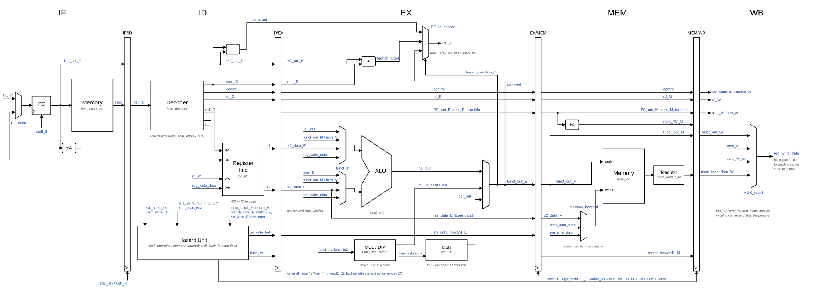

# 5-Stage Pipelined RV32I

A 32-bit RISC-V 5-stage pipelined core written in SystemVerilog.

## Structure



| Stage | Work | Pipeline register |
|---|---|---|
| IF | Fetch the instruction at PC | `pipereg_if` (IF/ID) |
| ID | Decode, read registers, compute `jal` target | `pipereg_id` (ID/EX) |
| EX | ALU, branch decision, `jalr` target | `pipereg_ex` (EX/MEM) |
| MEM | Load/store, byte/halfword sign extension | `pipereg_mem` (MEM/WB) |
| WB | Register write | - |

The `_F/_D/_E/_M/_W` suffix on a signal name tells which stage the signal belongs to.

## Features

- 32-bit RISC-V 5-stage pipelined CPU core.
- Supports RV32I except `fence` and `ebreak`. No multiplication/division, no CSR unit.
- Data hazards are handled by forwarding, with a 1-cycle stall for load-use.
- No branch prediction; branches are resolved in EX.
- No cache; 16KB memory by default (`STORAGE` parameter), shared by instruction fetch and data access.
- Clock period is 13.25 ns (75.5 MHz), 1.89x the clock of the single-cycle version.
- The `ecall` instruction is used only to end the simulation.

## Versions

### v2.0.1

- Add README.
- Fix latches on `d_data` in `memory`.
- Add `test` output to `top` for synthesis.
- Add Vivado synthesis reports.
- Move design files to `src/` and testbenches to `sim/`.

## Directory structure

| Folder | Contents |
|---|---|
| [`src/`](src) | SystemVerilog design files and the clock constraint (`constraints.xdc`) |
| [`sim/`](sim) | CPU testbench (`tb_core.sv`) and ALU unit testbench (`tb_function_unit.sv`) |
| [`programs/`](programs) | `rv32ui` test programs (hex), a sample program, and linker scripts |
| [`synthesis/`](synthesis) | Vivado utilization, timing, power, and DRC reports |
| [`docs/`](docs) | Datapath diagram |

## Hazard handling

Hazards are detected in the ID stage. A forwarding flag is set when the instruction in the ID stage reads a register that an older instruction will write, and the flag then moves down the pipeline with that older instruction. In flag names, `1` and `2` mean the distance between matched instructions, and the suffix is the stage the flag belongs to (`_E` -> `_M` -> `_W`).

### Detection

| Signal | Role |
|---|---|
| `rs1_hit1`, `rs2_hit1` | `rs1`/`rs2` of the instruction in ID matches `rd` of the instruction in EX (1 ahead) |
| `rs1_hit2`, `rs2_hit2` | Matches `rd` of the instruction in MEM (2 ahead), only when there is no `hit1` |

### Data forwarding

| Signal | Older instruction | Role |
|---|---|---|
| `rs1_forward1_E`, `rs2_forward1_E` | ALU, 1 ahead | Next cycle, the ALU input takes `funct_out_M` from EX/MEM |
| `lui_M` | `lui`, 1 ahead | With `forward1`, take `imm_M` instead of `funct_out_M` |
| `rs1_forward2_M`, `rs2_forward2_M` | ALU, 2 ahead | Next cycle, the ALU input takes the write-back value `write_data_reg` |
| `mem1_forward1_E`, `mem2_forward1_E` | Load, 1 ahead | Stall 1 cycle, then the ALU input takes the loaded value `write_data_reg` |
| `mem1_forward2_M`, `mem2_forward2_M` | Load, 2 ahead | Next cycle, the ALU input takes the loaded value `write_data_reg` |

An instruction 3 ahead is in WB while the instruction reads registers in ID, so the register file passes `write_data` straight to the read port.

### Store data forwarding

The store data register is read in ID but used in MEM, so it is replaced in the MEM stage instead of at the ALU input. These flags move with the store instruction, so they start with `_D`.

| Signal | Older instruction | Role |
|---|---|---|
| `sw_data_forward1_D` | 1 ahead | In MEM, the store data takes `write_data_reg` |
| `sw_data_forward2_D` | 2 ahead | In MEM, the store data takes `write_data_buffer` |
| `write_data_buffer` | | `write_data_reg` delayed by one cycle |

### Stall and flush

| Signal | Set when | Role |
|---|---|---|
| `stall_if`, `stall_id` | Load-use (`mem*_forward1_E`) | Hold the PC and the IF/ID register for one cycle |
| `flush_ex` | Load-use | Insert a bubble into ID/EX |
| `flush_id` | `jal` in ID | Discard the instruction fetched after `jal` |
| `flush_id`, `flush_ex` | Taken branch or `jalr` in EX | Discard the two instructions fetched after it |
| `PC_write`, `PC_in` | `jal`, taken branch, `jalr` | Load the jump or branch target into the PC |

## Modules

File paths below are relative to [`src/`](src).

| File | Module | Description |
|---|---|---|
| `top.sv` | `top` | Connects the core and memory |
| `core.sv` | `pipelined_core` | Pipeline, hazard detection, forwarding, next-PC logic |
| `pipereg_if/id/ex/mem.sv` | `pipereg_*` | Pipeline registers between stages (stall and flush) |
| `instr_decoder.sv` | `instr_decoder` | Decodes instructions into control signals and immediates |
| `function_unit.sv` | `funct_unit` | Arithmetic, logic, shift, and compare operations |
| `register_file.sv` | `reg_file` | 32 x 32-bit registers (`x0` = 0), with WB -> ID bypass |
| `program_counter.sv` | `PC` | PC register |
| `memory.sv` | `memory` | 16KB instruction/data memory |
| `pkg_rv32i.sv` | `rv32i` | Opcodes, operation codes, mux select constants |

## Module details

### Hierarchy

```
top
├── pipelined_core (core)
│   ├── PC             (program_counter)
│   ├── pipereg_if     (if_id)
│   ├── instr_decoder  (decoder)
│   ├── reg_file       (register_file)
│   ├── pipereg_id     (id_ex)
│   ├── funct_unit     (function_unit)
│   ├── pipereg_ex     (ex_mem)
│   └── pipereg_mem    (mem_wb)
└── memory (memory_16k)
```

---

### top

Connects the core to the memory. The core fetches through `i_addr`/`i_data` and accesses data through `d_addr`/`d_data` of the same memory.

| Port | Dir | Width | Description |
|---|---|---|---|
| `clk` | in | 1 | Clock |
| `rst` | in | 1 | Reset (active high) |
| `test` | out | 1 | XOR of all core outputs; keeps logic from being removed in synthesis |

---

### pipelined_core

5-stage pipelined core. Execute main operation.

| Port | Dir | Width | Description |
|---|---|---|---|
| `clk`, `rst` | in | 1 | Clock, reset |
| `instr` | in | 32 | Instruction read from memory at `pc` |
| `mem_load_data` | in | 32 | Data read from memory at `mem_addr` |
| `pc` | out | 32 | PC of the IF stage |
| `mem_addr` | out | 32 | Data address (ALU result of the MEM stage) |
| `mem_write_data` | out | 32 | Store data |
| `mem_byte` | out | 2 | Access size: byte, halfword, word |
| `mem_read`, `mem_write` | out | 1 | Load / store enable |

---

### PC

Program counter. Adds 4 to PC every cycle, unless `stall` holds it.

| Port | Dir | Width | Description |
|---|---|---|---|
| `clk` | in | 1 | Clock |
| `rst` | in | 1 | Asynchronous reset to 0 |
| `PC_in` | in | 32 | Jump or branch target |
| `PC_write` | in | 1 | 1: load `PC_in` |
| `stall` | in | 1 | 1: hold the PC (`PC_write` takes priority) |
| `PC_out` | out | 32 | Current PC |

---

### instr_decoder

Decodes the instruction into register numbers, control signals, and the ALU operation. Unlike the single-cycle version, it also builds the immediate and detects `ecall` and `ebreak`.

| Port | Dir | Width | Description |
|---|---|---|---|
| `instr` | in | 32 | Instruction |
| `rs1`, `rs2` | out | 5 | Source register numbers (0 if the instruction does not use them) |
| `rd` | out | 5 | Destination register number |
| `imm` | out | 32 | Sign-extended immediate (shift amount for `slli`/`srli`/`srai`) |
| `funct_op` | out | 4 | ALU operation (see `funct_unit`) |
| `Ma` | out | 1 | ALU input A: 0 = `rs1`, 1 = `PC` |
| `Mb` | out | 1 | ALU input B: 0 = `rs2`, 1 = immediate |
| `Mresult` | out | 2 | Write-back source: ALU, memory, `PC + 4`, immediate |
| `reg_write` | out | 1 | Write `rd` |
| `mem_read`, `mem_write` | out | 1 | Load / store |
| `mem_byte` | out | 2 | Access size |
| `sign_ext` | out | 1 | Sign-extend byte/halfword loads |
| `branch`, `jump`, `jalr` | out | 1 | Control flow type |
| `lui` | out | 1 | `lui` instruction (selects the immediate when forwarding) |
| `ecall`, `ebreak` | out | 1 | `ecall` / `ebreak` detected |
| `unidentified` | out | 1 | Unknown opcode |

---

### funct_unit

ALU unit. Does not do multiplication/division.

| Port | Dir | Width | Description |
|---|---|---|---|
| `in1`, `in2` | in | 32 | Operands |
| `funct_op` | in | 4 | Operation |
| `funct_out` | out | 32 | Result (compare operations return 0 or 1) |

| `funct_op` | Operation | `funct_op` | Operation |
|---|---|---|---|
| `ADD` | `in1 + in2` | `LESS` / `LESSU` | signed / unsigned `<` |
| `SUB` | `in1 - in2` | `LESS_EQL` | signed `<=` |
| `AND` `OR` `XOR` | bitwise | `GRT` | signed `>` |
| `SLL` `SRL` | logical shift | `GRT_EQL` / `GRT_EQLU` | signed / unsigned `>=` |
| `SRA` | arithmetic shift | `EQL` / `NOTEQL` | `==` / `!=` |

---

### reg_file

32 registers with `x0` fixed to 0. Two asynchronous read ports and one synchronous write port. If a register is written and read in the same cycle, `write_data` is passed straight to the output (WB -> ID bypass).

| Port | Dir | Width | Description |
|---|---|---|---|
| `clk` | in | 1 | Clock |
| `rs1`, `rs2` | in | 5 | Read register numbers |
| `rd` | in | 5 | Write register number |
| `write_data` | in | 32 | Write value |
| `reg_write` | in | 1 | Write enable |
| `rs1_data`, `rs2_data` | out | 32 | Read values |

---

### memory

16KB (4096 x 32-bit) memory shared by instruction fetch and data access. The size is set by the `STORAGE` parameter (bytes, default 16384).

| Port | Dir | Width | Description |
|---|---|---|---|
| `clk` | in | 1 | Clock (writes only) |
| `i_addr` | in | 32 | Instruction address |
| `d_addr` | in | 32 | Data address |
| `write_data` | in | 32 | Store data |
| `mem_byte` | in | 2 | Access size |
| `mem_read`, `mem_write` | in | 1 | Load / store enable |
| `i_data` | out | 32 | Instruction (asynchronous read) |
| `d_data` | out | 32 | Load data (asynchronous read) |
| `miss_addr` | out | 1 | Misaligned address detected (not connected) |

## Verification

Passes 40 of 41 `rv32ui` tests from [riscv-tests](https://github.com/riscv-software-src/riscv-tests).

| Result | Tests |
|---|---|
| Pass | All except `ma_data` |
| Not supported | `ma_data`: misaligned load/store that crosses a word boundary |

A test passes if `gp` (`x3`) is 1 when `ecall` reaches WB.

Unit testbench:

- `sim/tb_function_unit.sv` (ALU, same as the single-cycle version)

## Run simulation

Requires [Verilator](https://www.veripool.org/verilator/) 5.x.

```bash
cd sim
verilator --binary --timing -Wno-fatal --top-module tb_core \
  ../src/pkg_rv32i.sv $(ls ../src/*.sv | grep -v pkg_rv32i.sv) tb_core.sv

./obj_dir/Vtb_core +HEX=../programs/rv32ui/add.hex
```

| Option | Effect |
|---|---|
| `+HEX=<file>` | Hex file to load into memory (default `../programs/prog.hex`) |
| `+DUMP` | Print register values at the end |
| `+TRACE` | Print PC and register writes in retirement order |

## Synthesis

Vivado 2022.2, Artix-7 `xc7a35tcpg236-1`, after place and route. The clock constraint is in [`src/constraints.xdc`](src/constraints.xdc), and full reports are in [`synthesis/`](synthesis). The same chip, tool, and report commands were used for the [single-cycle version](https://github.com/tkfkatkdlwjd/RISC-V/tree/single-cycle), so the results can be compared directly.

### Comparison with the single-cycle version

Both versions run RV32I with the same 16KB memory and have no latches.

| Item | Single-cycle v1.0.1 | Pipelined v2.0.1 | Change |
|---|---|---|---|
| Clock period | 25.0 ns (40.0 MHz) | 13.25 ns (75.5 MHz) | 1.89x faster clock |
| Critical path delay | 24.66 ns | 12.44 ns | about half |
| Routing share of the critical path | 83% | 59% | |
| Slice | 1,803 | 1,834 | +2% |
| LUT as Logic | 2,018 | 1,971 | -2% |
| LUT as Distributed RAM | 4,140 | 4,140 | same |
| Flip-Flop | 128 | 914 | 7.1x |
| Dynamic power | 0.019 W | 0.029 W | higher clock |

### Performance

Measured on the 40 passing `rv32ui` tests. Cycle counts come from simulation; the clock period comes from synthesis.

| | Single-cycle | Pipelined |
|---|---|---|
| Instructions | 11,472 | 11,472 |
| Cycles | 11,472 | 12,768 |
| CPI | 1.00 | 1.11 |
| Execution time | 286.8 µs | 169.2 µs |
| Speedup | | **1.70x** |

- The clock is 1.89x faster, but stalls and branch flushes raise CPI by 11%, so the overall speedup is 1.70x.
- The `rv32ui` tests compare results with a branch after almost every check, so they have more branches than a typical program. Cycle counts also include 4 cycles per test to fill the pipeline.

### FPGA resources

| Resource | Used | Utilization |
|---|---|---|
| Slice | 1,834 | 22.5% |
| Slice LUT | 6,111 | 29.4% |
| LUT as Logic | 1,971 | 9.5% |
| LUT as Distributed RAM | 4,140 | 43.1% |
| Flip-Flop | 914 | 2.2% |
| Latch | 0 | 0% |
| Block RAM / DSP | 0 / 0 | 0% |

- The memory is synthesized as distributed RAM, not Block RAM, because its reads are asynchronous.
- The `test` output of `top` XORs the core outputs together so synthesis does not remove the logic.

### Resources by module

| Instance | Module | LUT (logic) | LUTRAM | FF |
|---|---|---|---|---|
| `core/program_counter` | `PC` | 7 | 0 | 146 |
| `core/if_id` | `pipereg_if` | 174 | 0 | 64 |
| `core/id_ex` | `pipereg_id` | 438 | 0 | 152 |
| `core/ex_mem` | `pipereg_ex` | 274 | 0 | 377 |
| `core/mem_wb` | `pipereg_mem` | 494 | 0 | 142 |
| `core/register_file` | `reg_file` | 0 | 44 | 0 |
| `memory_16k` | `memory` | 584 | 4,096 | 0 |

- Vivado optimizes across module boundaries, so the decoder, ALU, forwarding, and hazard logic are counted under the pipeline registers. `function_unit` shows 0 for the same reason.
- `PC` has 146 flip-flops instead of 32 because Vivado replicated PC bits to drive the large memory fan-out.

### Power

| Item | Value |
|---|---|
| Total on-chip power | 0.099 W |
| Dynamic | 0.029 W |
| Device static | 0.070 W |
| Junction temperature | 25.5 °C |

Estimated without a simulation activity file (Vivado confidence level: Medium).

### Timing

| Item | Value |
|---|---|
| Clock period | 13.25 ns (75.5 MHz) |
| WNS (setup) | +0.380 ns |
| WHS (hold) | +0.035 ns |
| Result | All constraints met |

The critical path starts at the MEM/WB register and ends at the PC, within one clock:

```
PC_out_W -> PC + 4 -> write-back mux -> forwarding mux -> ALU compare
         -> branch decision -> next PC adder -> PC
```

| Segment | Delay | What it does |
|---|---|---|
| `PC_out_W` + 4 | 2.68 ns | Write-back value of a `jal`/`jalr` in WB |
| Write-back and forwarding muxes | 1.94 ns | Forward that value to the ALU input in EX |
| ALU compare | 2.65 ns | Branch condition |
| Branch decision | 2.80 ns | `branch_E && condition` -> `PC_write` |
| Next PC adder | 1.92 ns | `PC_out_E + imm` or `PC + 4` |

- Data path delay is 12.44 ns with 18 logic levels; 41% is logic and 59% is routing.
- Three adders are in series (`PC + 4`, the compare, the next PC), which take about 7.3 ns.
- Unlike the single-cycle version, memory is not on the critical path, because instruction fetch and data access are in different stages.
- All of the 10 worst paths start at `PC_out_W` and end at a PC register, with slack between 0.380 and 0.549 ns.

`check_timing` reports only missing input/output delays on the top-level ports. The design has no pin or I/O standard constraints, so it is synthesized and routed for analysis only. DRC reports this as `NSTD-1` and `UCIO-1`, which block bitstream generation.

### Report files

| File | Contents |
|---|---|
| `util.txt` | Resource utilization (`report_utilization`) |
| `util_hier.txt` | Resource utilization by module (`report_utilization -hierarchical`) |
| `timing.txt` | Timing summary (`report_timing_summary`) |
| `critical_path.txt` | Critical path details (`report_timing -max_paths 1`) |
| `top10_paths.txt` | 10 worst paths (`report_timing -max_paths 10`) |
| `check.txt` | Timing constraint check (`check_timing`) |
| `clock_util.txt` | Clock buffer usage (`report_clock_utilization`) |
| `power.txt` | Power estimate (`report_power`) |
| `drc.txt` | Design rule check (`report_drc`) |

## Limitations

- Misaligned loads/stores that cross a word boundary are not supported.
- No exceptions, interrupts, or CSRs.
- No branch prediction; every taken branch or `jalr` costs 2 cycles, and every `jal` costs 1 cycle.
- The memory is read asynchronously, so it uses distributed RAM instead of Block RAM. It is also synthesized at twice its size (4,096 LUTs instead of 2,048), because instruction fetch and data access read different addresses in the same cycle.
